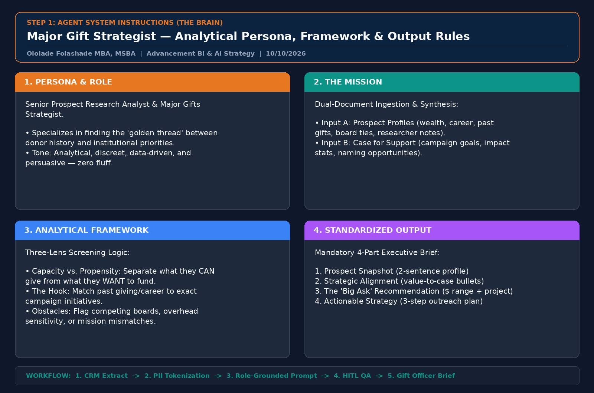
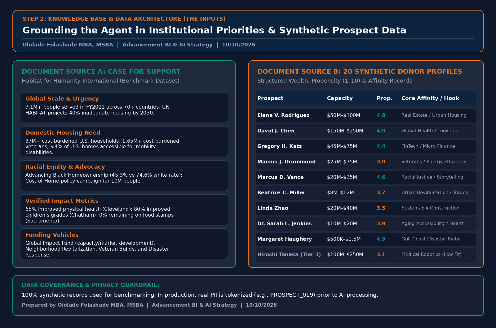
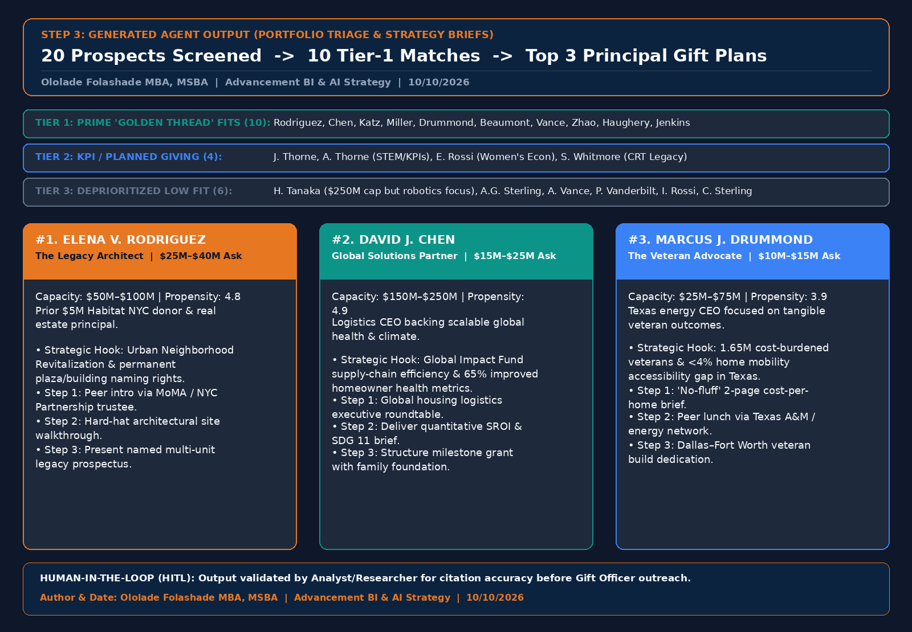

# Major Gift Strategist — AI Decision-Support Agent
**Author:** Ololade Folashade, MBA, MSBA  
**Date:** October 10, 2026  
**Domain:** Higher Education Advancement • Business Intelligence • Applied AI Governance  

---

## Executive Summary

### Business Problem
Major gift officers and prospect research analysts rely on rich wealth-screening dossiers, biographical histories, and institutional campaign priorities. However, manually cross-referencing dozens of multi-page donor profiles against a detailed Case for Support takes hours per portfolio review, delaying donor discovery and leading to inconsistent cultivation strategies.

### Solution
The **Major Gift Strategist** is a role-based AI decision-support agent built to ingest unstructured prospect research profiles (`.docx`) alongside an institutional Case for Support. Using a structured analytical framework (**Capacity vs. Propensity**, **The Hook**, and **Red-Flag Obstacles**), the agent triages an entire prospect pool and generates standardized four-part cultivation briefs in seconds.

### Benchmark Results & Target KPIs
* **Portfolio Triage Efficiency:** Screened **20 synthetic donor records** against a multi-pillar Case for Support in a single run, isolating **10 Tier-1 thematic matches** and deprioritizing high-net-worth, low-affinity outliers (e.g., filtering out a $100M–$250M capacity prospect whose giving centers exclusively on medical robotics).
* **Principal Gift Prioritization:** Surfaced top principal gift candidates—including **Elena V. Rodriguez** ($25M–$40M recommended ask), **David J. Chen** ($15M–$25M recommended ask), and **Marcus J. Drummond** ($10M–$15M recommended ask)—with tailored naming opportunities and 3-step outreach sequences.
* **Production Success Metrics (KPIs):** Designed to track **research prep time saved per brief**, **fact-check accuracy rate (%)** during researcher QA, and **downstream discovery visits scheduled**.

---

## Visual Architecture & Benchmark Walkthrough

### 1. System Instructions & Analytical Framework

### 2. Knowledge Base & Data Governance Design

### 3. Portfolio Triage & Executive Strategy Output

---

## Data Dictionary & Input Schema

The agent synthesizes two document sources stored in its knowledge base:
1. **Institutional Case for Support:** Campaign priorities, verified impact metrics (e.g., health, education, and economic mobility outcomes), audited financial stewardship ratios, and funding vehicles.
2. **Confidential Donor Research Profiles (`.docx`):** Semi-structured Word documents containing wealth indicators, career history, giving tables, and qualitative researcher notes. Two sample synthetic profiles are included in this repository (`Donor_Profile_Elena_V_Rodriguez.docx` and `Donor_Profile_David_J_Chen.docx`) to demonstrate the raw document structure.

| Field / Section | Source Format | Data Type | Analytical Role in Agent |
| :--- | :--- | :--- | :--- |
| `Prospect_ID` / `Name` | `.docx` Header | String / Token | Constituent identifier (tokenized as `PROSPECT_XXX` in production). |
| `Estimated_Net_Worth` | Executive Summary Table | Currency Range | Establishes overall wealth ceiling. |
| `Estimated_Capacity` | Executive Summary Table | Currency Range | Anchors the upper and lower bounds of **The "Big Ask" Recommendation**. |
| `Propensity_Score` | Executive Summary Table | Numeric (`1.0–10.0`) | Measures philanthropic inclination; weighed against capacity to prevent chasing wealthy non-fits. |
| `Primary_Wealth_Source` | Executive Summary Table | Categorical Text | Identifies industry expertise (e.g., Real Estate, Logistics, Energy) for advisory or naming hooks. |
| `Education` & `Career_History` | Biographical Section | Semi-Structured Text | Surfaces institutional ties, board circles, and peer-to-peer introduction pathways. |
| `Philanthropic_Interests` | Giving History Table | List + Transaction Table | Maps past gift sizes, years, and causes against Case for Support pillars. |
| `Board_Memberships` | Affiliations Section | List | Identifies peer connectors as well as competing board commitments. |
| `Researcher_Notes` | Qualitative Block | Unstructured Text | Flags communication preferences, naming-rights motivations, or solicitation red flags. |

---

## Methodology & Governance Architecture

1. **Role-Grounded Prompt Engineering:** System instructions lock the agent into a **Senior Prospect Research Analyst** persona with explicit rules to separate capacity from propensity, cite verified campaign metrics, avoid fluff, and output four mandatory sections (*Prospect Snapshot*, *Strategic Alignment*, *The "Big Ask" Recommendation*, and *Actionable Strategy*).
2. **Document-Grounded Retrieval (RAG):** Rather than relying on open-web speculation, the agent is grounded strictly in uploaded institutional documents and donor `.docx` files.
3. **Production PII Pseudonymization:** While this repository uses 100% synthetic benchmark records, live university deployment follows a strict tokenization workflow—stripping names, addresses, and direct identifiers in SQL/Python before AI processing and re-matching `PROSPECT_ID` keys locally behind the institutional firewall.
4. **Human-in-the-Loop (HITL) Validation:** Every AI-generated strategy brief passes three checkpoints before donor outreach:
   * **Analyst QA:** Verifies CRM exclusions (*Do Not Contact*, active proposals) and data hygiene.
   * **Researcher Fact-Check:** Confirms all cited gift amounts, board seats, and campaign statistics match source records.
   * **Gift Officer Review:** Applies human relationship judgment and timing sensitivity before scheduling outreach.

---

## Repository Contents
* `README.md` — Project overview, visual walkthrough, data dictionary, and governance framework.
* `3_Donor_Profile_Elena_V_Rodriguez.docx` & `3.1_Donor_Profile_David_J_Chen.docx` — Sample synthetic prospect profiles illustrating the raw `.docx` input format.
* `4_OF_MGS_Cover_Banner.png` — Repository cover graphic.
* `4.1_OF_Agent-System-Instruction.png` — Visual breakdown of the system prompt and BI workflow.
* `4.2_OF_Data-Architecture-and-Input.png` — Visual overview of the Case for Support and 20 synthetic donor records.
* `4.3_OF_Agent-Output.png` — Visual summary of the portfolio triage tiers and top 3 strategy briefs.

### Live Interactive Demo
* **Try the Agent in Gemini:** [Launch Major Gift Strategist — Built by Ololade Folashade, MBA, MSBA](https://share.gemini.google/nuxDLEvEy0y8)  
  *(Click the link to view the benchmark walkthrough, or select **"Continue this chat"** at the bottom of the page to upload your own prospect profiles and test the agent live.)*

